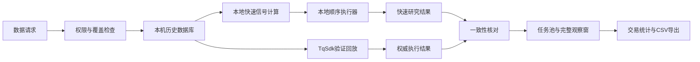

# 本地快速研究、完整观察窗与回测槽位设计

状态：用户已确认方向，本文合并并替代此前“所有研究迭代都通过TqSdk事件回放”的性能假设。

## 目标

用户选择的日期范围内，历史行情已经是确定数据。研究迭代应先复用本机数据并在内存中快速计算，
再将少量候选策略交给原版TqSdk回放核对。成功标准是：

- 同一数据范围只获取一次，后续实验直接复用；
- 双均线等分钟策略的处理速度不再由SDK事件循环和逐柱数据库提交决定；
- 用户能明确区分“快速研究回测”和“TqSdk验证回测”，两者不会混为同一可信级别；
- 回测前可配置1—4个计划任务，统一点击一次开始，不再靠反复调整并发数来制造任务卡；
- 每个任务可以打开独立完整观察窗，包含进度、K线、账户、成交和交易统计；
- 交易明细可筛选、统计和导出CSV；
- CPU为当前执行后端，CUDA只有存在经过验证的GPU执行器时才能选择，不能提供无效开关。

## 核心修正

“策略有因果顺序”不等于“每根K线必须等待网络或SDK外部事件”。

本地快速回测分为：

1. 已完成柱信号计算：可在整段数组上批量或窗口化计算。
2. 执行状态推进：持仓、成交、止损、反手和资金必须按时间顺序执行，但只在本机内存中完成。
3. 结果持久化：计算完成后批量保存检查点、成交和报告，不把每根柱的账户快照作为主循环I/O。

原版TqSdk回放继续保留，用于执行环境一致性和成交成本验证，不再是每次参数试验的唯一引擎。

## 数据边界

### 原始数据与信号数据

- 保存实际合约的未调整OHLCV、成交量和持仓量。
- 单独保存历史主力映射、切换时间和因果价差。
- 连续信号价格由实际合约和历史映射按因果规则生成，不回写原始价格。
- 分钟回测使用完成柱；形成柱不能参与信号。
- Tick精度需要保存逐Tick或至少足够细的路径数据。只有分钟OHLC时，同柱止损与止盈的先后顺序
  无法精确确定，结果必须标记为“分钟近似”。

### 数据获取权限

- 官方`DataDownloader`是长区间批量导出路径；该功能需要天勤专业或`tq_dl`权限。
- 免费账户能否取得完整分钟/Tick范围必须以实际接口返回核实，不能假定所有历史都可下载。
- 用户已在合法TqSdk回放中处理过的柱可以增量缓存到本机，但`TqBacktest`不能当作任意长区间导出工具。
- 数据权限不足、覆盖缺口、交易日历缺失或合约映射不足时必须停止，不能静默缩小日期或改用今天的合约。

## 总体架构

### 历史数据库

首版使用本机SQLite保存规范化数据，避免新增大型依赖：

- `data_sets`：数据范围身份、品种、周期、精度、来源、权限、校验和与状态；
- `instruments`：实际合约及乘数、价格跳、保证金和费用模型来源；
- `bars`：实际合约完成柱，按`symbol,duration,time_ns`唯一；
- `ticks`：Tick快照或有权限取得的逐笔数据，按数据源定义唯一身份；
- `main_changes`：历史主力切换和因果偏移；
- `coverage`：交易日、有效柱数、缺口和异常证据。

读取时用一次范围查询载入NumPy数组，不能在逐柱循环中反复查询SQLite。

### 快速研究引擎

`LocalBacktestEngine`的职责：

- 只接受通过覆盖检查的数据集；
- 生成未使用未来数据的信号；
- 用内存状态机执行开仓、加仓、部分成交、止损、阶梯保护、止盈、反手和换月；
- 计算逐成交费用、保证金、现金、权益、回撤和逻辑交易；
- 结果使用与TqSdk结果相同的外部契约，增加`engine_kind=local_research`和精度标签；
- 运行期间不写逐柱大型JSON；终态和检查点批量落盘。

首版只实现双均线和当前金额保护规则。共享资金组合、其他策略和实盘执行不在本阶段内。

### TqSdk验证引擎

现有`execute_research`保留为`engine_kind=tqsdk_validation`。

- 快速研究选出的候选策略再次运行；
- 比较信号、目标、实际成交、费用和终态；
- 允许因撮合差异产生明确差异，但不能静默把两者标为相同；
- 验证失败或差异超阈值时，候选策略不能进入模拟阶段。

### 计算后端

计算后端配置为：

- `cpu`：可用；本地顺序执行器和多进程参数任务；
- `cuda`：只有在策略实现GPU内核、CUDA可用且一致性测试通过后才显示为可选；
- `auto`：首版不提供，避免隐藏的设备选择和回退。

GPU适合同时计算大量参数组合、蒙特卡洛、Tick特征矩阵和机器学习。单个状态机回测不承诺CUDA。

## 回测槽位

研究页分为可收起策略编辑区、计划槽位区和运行任务区。

1. 选择并发数`N=1..4`，页面显示N个计划槽位。
2. 每个槽位显示名称、品种、周期、日期、数据和计算后端，旁边提供“配置策略”。
3. “配置策略”展开现有参数表单并绑定到该槽位；保存后形成不可变实验修订。
4. 所有槽位统一由“开始全部回测”提交。
5. 提交前执行全部校验和全部数据覆盖检查；任何槽位失败时整批不启动并定位对应槽位。
6. 开始后槽位冻结为任务卡。用户可以新增一个计划槽位并单独点击“开始新增任务”，
   不需要改变当前并发上限。
7. 等待中或终态任务可删除；运行中任务先停止再删除。

并发数限制同时运行数量，不限制计划槽位总数。

## 完整观察窗

独立窗口不是天勤图表裸页面，而是本机只读研究页。内容包括：

- 任务名称、状态、进度、历史时间、耗时和停止/失败原因；
- K线、成交和保护轨迹；
- 账户指标、持仓、委托、成交和交易明细；
- 交易筛选、统计和CSV导出；
- 任务运行中自动刷新，结束后保留完整结果。

观察窗只读，不提供下单、修改实验或删除任务的接口。多个任务各自拥有独立观察窗和图表绑定。

## 交易筛选与统计

原始交易行不可编辑。可编辑的是筛选和显示条件：

- 日期范围；
- 合约；
- 多/空；
- 持仓中/已平仓；
- 退出原因；
- 最小/最大净盈亏。

统计字段：

- 交易数、盈利笔数、亏损笔数、持平笔数、胜率；
- 毛盈亏、手续费、净盈亏；
- 平均盈利、平均亏损、最大单笔盈利、最大单笔亏损；
- 已实现盈亏总和、当前未平仓数和未平仓浮盈。

导出使用通过相同筛选函数的CSV，页面统计与CSV必须使用同一批交易。

## 错误与一致性

- 数据缺口、权限不足、主力映射不足和交易日历失败阻止启动；
- 快速引擎和TqSdk引擎结果分别标识；
- 数据源、引擎版本、策略版本、代码版本和费用模型纳入结果身份；
- CUDA请求在没有GPU执行器时明确拒绝，不自动回退CPU；
- 旧结果保持只读，缺失字段显示未记录；
- 观察窗读取失败不能停止后台计算；
- 关闭主工作台后，本机观察窗服务停止；
- 凭证不进入数据包、结果、观察窗URL、日志或任务计划。

## 性能验收

- 8,000根一分钟双均线在数据已缓存、无实时图形时的本地引擎应使用内存数据完成，
  不以当前`872.9秒`作为可接受基线；
- 报告获取、数据校验、信号、执行、结果保存和图表准备的分阶段耗时；
- 相同冻结输入重复3次，记录中位数；
- 本地引擎与TqSdk验证在约定容差内核对信号、成交数量、费用、净持仓和终态权益；
- 分钟近似同柱止损与止盈冲突必须使用保守规则或标记不确定，不伪造Tick精度；
- 100个参数的性能报告必须区分数据加载、CPU并行和结果保存耗时，不用GPU占用率代替指标。

## 测试策略

- 数据层：权限、缺口、重复柱、合约映射、覆盖版本和只读完整性；
- 本地引擎：因果信号、下一可实现价格、滑点、费用、部分成交、止损顺序、反手、换月和资金不足；
- 一致性：同一策略与TqSdk样本的逐信号和终态差异；
- 槽位：N行、全验证后启动、并发上限、运行中新增和删除；
- 观察窗：运行/完成/失败、多窗口隔离、进度和交易统计；
- 导出：筛选统计与CSV逐行/逐金额一致；
- 性能：固定数据、重复3次、结果指纹一致；
- GPU：只测试已实现后端；无CUDA环境返回明确能力状态。

## 实施拆分

两个计划共享本文接口，但可分别交付：

1. `docs/superpowers/plans/2026-10-20-complete-observer-and-slot-workflow.md`
2. `docs/superpowers/plans/2026-10-20-local-fast-backtest-engine.md`

先交付观察窗、交易分析和槽位工作流，用户可以立即改善现有TqSdk任务操作。再交付数据缓存和本地快速引擎；
本地结果通过TqSdk样本验证后才成为默认研究引擎。

## 非目标

- 本阶段不实现实盘入口；
- 不把独立TqSim任务收益相加为共享资金组合；
- 不为单条Python状态机强上CUDA；
- 不使用未来数据、当前行情或估算值填补历史缺口；
- 不引入全市场自动录制、自研撮合器或机器学习平台。
